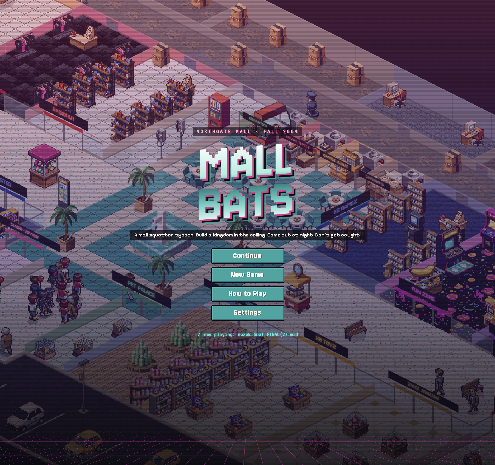

# Mall Bats

A mall-squatter tycoon. Build a kingdom in the ceiling of a dying 2004 mall. Come out at night. Don't get caught.

**[Play it in your browser](https://mall-bats.vercel.app)**. Free, no install.



Northgate Mall goes to auction on December 31, 2004. You and a crew of misfits live above the drop ceiling, running night jobs past Gary the security guard, stealing power from the stores below, and hoarding cash. Have more than the developer bids by New Year's Eve and the mall is yours.

## Running it

```sh
npm install
npm run dev          # http://localhost:5173
```

| Command | What it does |
| --- | --- |
| `npm run build` | Typecheck and build the web version into `dist/` |
| `npm run check` | Deterministic checks for placement, jobs, suspicion, inspections, and saves ([Bun](https://bun.sh)) |
| `npm run desktop` | Build and open the Electron app |
| `npm run dist:mac` / `dist:win` | Package desktop builds into `release/` |
| `npm run balance -- normal <seed>` | Play a full game with the balance bot ([Bun](https://bun.sh) required) |

## Layout

| Path | Contents |
| --- | --- |
| `src/game/` | The simulation: crew AI, NPCs, inspections, economy, events. No DOM. |
| `src/render/` | Isometric canvas renderer |
| `src/ui/` | HUD and menus (Preact) |
| `scripts/bot.ts` | Headless bot that plays whole runs for balancing |
| `scripts/check.ts` | Short deterministic checks. Run before changing rules |
| `scripts/art/` | Sprite pipeline (generate, review, palette-snap) |
| `art/` | Art style guide, palette, asset specs and raw candidates |
| `VOICE.md` | How the game talks. Read it before writing copy. |
| `SYSTEMS.md` | How a tick, a save, and a Bat actually work. Read it before changing rules. |

## Art

The sprites were generated with [PixelLab](https://pixellab.ai), then curated by hand and snapped to a fixed palette. `art/STYLE.md` has the rules. Regenerating art needs a `PIXELLAB_SECRET` in `.env`. Playing and building the game do not.

## Contributing

Issues and pull requests are welcome. Before opening a PR, run `npm run build`, `npm run check`, and a few bot seeds to check that balance hasn't shifted:

```sh
for s in 1 2 3 4 5 6; do bun scripts/bot.ts normal $s & done; wait
```

## License

The code and writing are licensed under the [GNU GPL v3.0 or later](LICENSE). The art in `art/` and `src/assets/` is licensed under [CC BY-NC-SA 4.0](https://creativecommons.org/licenses/by-nc-sa/4.0/).

Northgate Shopping Centre is a real mall in North Bay. The auction, the crew, and the ceiling kingdom are not.
